<a href="https://teralis.pro/tera">
  <picture>
    <source media="(prefers-color-scheme: dark)" srcset="./assets/telemetry-dark.svg" />
    <source media="(prefers-color-scheme: light)" srcset="./assets/telemetry-light.svg" />
    
  </picture>
</a>

 

<a href="https://teralis.pro">
  <picture>
    <source media="(prefers-color-scheme: dark)" srcset="./assets/sheet-dark.svg" />
    <source media="(prefers-color-scheme: light)" srcset="./assets/sheet-light.svg" />
    
  </picture>
</a>

 

  
  
  
  

Versão textual e índice acessível dos sistemas privados (TeralisTech)

### Teralis Tecnologia da Informação ([teralis.pro](https://teralis.pro))

Engenharia de software sob medida, atendimento comercial com IA 24/7 no WhatsApp e plataformas corporativas de ponta a ponta. Todos os sistemas abaixo operam em repositórios privados em [github.com/TeralisTech](https://github.com/TeralisTech) por sigilo comercial e propriedade intelectual dos clientes.

| # | Sistema | Frente | Resumo |
| :--- | :--- | :--- | :--- |
| 01 | **TERA Platform** | IA & WhatsApp · teralis.pro/tera | Atendente comercial e suporte 24/7 treinada com as regras do negócio. Responde em ~3s, qualifica orçamentos e agenda no Google Calendar. |
| 02 | **Teralis Web Engine** | Portais & Catálogos | Vitrines imobiliárias e comerciais de abertura < 0.6s com importação automatizada do catálogo existente em menos de 24 horas, sem recadastro. |
| 03 | **Teralis Ops CRM** | Gestão Comercial · Privado | Painel interno de funil comercial, contratos, propostas e operações B2B substituindo planilhas frágeis por telemetria e visão em tempo real. |
| 04 | **Teralis Gaming** | Esports SaaS · Privado | Plataforma completa de torneios com salas de veto em tempo real via WebSockets, chaves eliminatórias ou Round Robin e balanço financeiro. |
| 05 | **Sistemas Sob Medida** | Memory · NoPrazo · PSS Amparo | Ecossistema privado de aplicações web e mobile para gestão financeira, controle de prazos e operações corporativas com 100% de propriedade do cliente. |

**Contato oficial:** [teralis.pro](https://teralis.pro) | [WhatsApp](https://wa.me/5519971691868) | [murilofdal@gmail.com](mailto:murilofdal@gmail.com) | [LinkedIn](https://linkedin.com/company/teralis-tecnologia)

